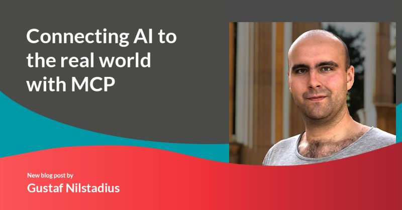

# Data analytics trend - LLMs or "Agentic AI for data analytics"

## A new user - the LLM {.smaller}

> Recently since 2026 a new group of "users" which traditionally UX designers have not considered or designed for has emerged.... **"AI Agents"** - robots / apps / bots / tools that make use of LLMs....

My take is that Open Alex abandonded their web-ui efforts due to focusing on requirements at the data level for ergonomic LLM usage.

A standard (like robots.txt for traditional web crawlers) is proposed for providing information to help LLMs use a website at inference time, "llms.txt"... see [https://llmstxt.org/](https://llmstxt.org/) and [https://swemetrics.se/llms.txt](https://swemetrics.se/llms.txt)

Examples - **QBOT**, **FOODBOT*** and look at **various Open Alex API docs updates**, which now focus on supporting usage from AI Agents. Sources:

- [https://www.youtube.com/watch?v=BX5qFM8j9MU](https://www.youtube.com/watch?v=BX5qFM8j9MU)
- [https://www.youtube.com/watch?v=-il55OzIKk8](https://www.youtube.com/watch?v=-il55OzIKk8)


## Zeitgeist and data analytics gurus {.smaller}

Generally, the zeitgeist amongst software developers is often characterized by existential angst and upheaval, chaotic times with many questioning traditional practices - some are early adaptors, others resist and various factions predict doom and salvation simultaneously.

What trends do prominent data analytics gurus like **Hadley Wickham** (fame: R for Data Science, tidyverse, dplyr, arrow, Posit) and **Wes McKinney** (fame: Python for data analysis, pandas, Posit) see?

- [https://wesm.spicytakes.org/](https://wesm.spicytakes.org/) - on the role of Python versus Go/Rust etc when building tools...

Use go for building tools for specific tasks: [python guru reconsiders](https://www.rilldata.com/blog/the-day-pythons-most-famous-developer-realized-agents-dont-care-about-readability) (Wes McKinney of arrow / pandas)

## Anthropic / Claude Code - TUI revolution {.smaller}

Claude Code enables various generally flexible workflows when developing solutions...

For example you can run your LLMs locally (Local AI) if you use claude code as a TUI to ollama

- [using claude code with ollama](https://medium.com/@joe.njenga/i-tried-new-claude-code-ollama-workflow-its-wild-free-cb7a12b733b5)

## What is MCP?

Model Context Protocol and why it matters to LLMs



[Link to Redpill Linpro Tech Blog](https://www.redpill-linpro.com/techblog/2026/02/24/AI-MCP-Basics.html?hss_channel=lcp-285766)

## LLM - Tools and Skills {.smaller}

Claude Code can be tuned to work the way you prefer and no one wants to waste tokens ($TOKEN-BILLIGT?), so ...

- Use LSP servers to speed up code searches: [LSP servers in Claude Code](https://karanbansal.in/blog/claude-code-lsp/)

And it can be extended with Tools (MCP) and Skills:

- [Anthropic about Skills and MCP server tools](https://claude.com/blog/extending-claude-capabilities-with-skills-mcp-servers)

## How can we curate and explore KTH data using LLMs? {.smaller}

The github.com/mskyttner/caddy-duckdb-module which exposes a(ny) duckdb as a REST API now also has a mcp endpoint for LLM use. An AI agent like Claude can use the Model Context Protocol (mcp) server connections against duckdb databases can use a range of MCP tools while exploring it, where the tools are designed to not waste tokens while exploring large data...

To get connected, use Claude Code MCP config:

```json
{
  "mcpServers": {
    "swemetrics": {
      "type": "http",
      "url": "https://swemetrics.se/duckdb/mcp",
      "headers": {
        "X-API-Key": "your_swemetrics_api_key_here"
      }
    }
  }
}
```

## Tools ... {.smaller}

For example in Claude Code add a connection via CLI (adds to the project .mcp.json):


```bash
  claude mcp add --transport http swemetrics https://swemetrics.se/duckdb/mcp \
    -H "X-API-Key: your_swemetrics_api_key_here"
```

- "type": "http" — uses streamable-HTTP transport (what caddy-duckdb's /mcp endpoint implements)
- The headers block passes the API key on every request — Claude Code sends it automatically
- After editing .mcp.json, restart Claude Code (or run /mcp to reload) for the new server to appear

The tools will then be available.

> Try "in swemetrics, how many citations are there for Tobias Jeppsson?" for example.

## Skills {.smaller}

Now it is all about adding "Skills", for example:

- Use "skills" from Posit for R / quarto / shiny etc: [R skills](https://github.com/posit-dev/skills)
- Use "skills" from duckdb: [duckdb skills](https://github.com/carlopi/duckdb-claude-skills)
- Use general "data analytics" skills: [general BI / data analytics skills](https://github.com/nimrodfisher/data-analytics-skills)
- Develop "skills" for KTH curation (specific KTH curator, bibliometric analyst skills?)
